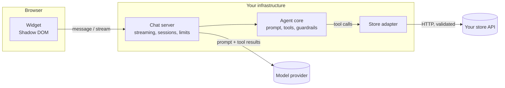

# Agentic Shopping Assistant

A chat widget for online stores whose AI assistant can **act**, not just talk: it searches, compares, fills the cart and applies discount codes, through a small API that the store provides.

[](https://github.com/amna9876/new-projects-/actions/workflows/ci.yml)
[](./LICENSE)


<!-- DEMO GIF PLACEHOLDER: record a walkthrough with `pnpm demo:scripted`, save it as
     docs/assets/demo.gif and replace the screenshot above. -->

## Contents

- [Why](#why)
- [Features](#features)
- [Quick start](#quick-start)
- [How it works](#how-it-works)
- [Embed it in your site](#embed-it-in-your-site)
- [Connect your store](#connect-your-store)
- [Security](#security)
- [Roadmap](#roadmap)
- [Contributing](#contributing)

## Why

Most shop chatbots can only answer questions. When a shopper says _"add the black one"_, they reply with instructions.

Letting an AI model act in a store has its own risks: it can invent a price, apply a discount nobody offered, or obey instructions hidden in a product description.

This project shows one way to do it safely:

- The assistant acts through **nine narrow tools** and nothing else.
- Every price, stock level, discount and total comes **from the store**, never from the model.
- The rules that matter are **enforced in code**, not only asked for in a prompt.
- A store integrates by implementing **one documented contract**, with a test suite that proves it.

## Features

| For shoppers                                | For store owners                               | For engineers                                   |
| ------------------------------------------- | ---------------------------------------------- | ----------------------------------------------- |
| Streaming chat with starter suggestions     | One `<script>` tag to embed                    | OpenAPI 3.1 contract generated from Zod schemas |
| Product cards and a comparison table        | Themable with CSS variables and `data-*`       | Contract test suite any store can run           |
| Live cart with the store's own totals       | Shadow DOM: no CSS clashes with your site      | Guardrails enforced in code                     |
| Variant picker and checkout hand-off        | Works with any store that follows the contract | Rate limiting, strict CORS, server-side history |
| Accessible, responsive to 360 px, LTR + RTL | Anthropic, Gemini, Groq or a local model       | 300+ tests and browser tests, no API key needed |

## Quick start

You need Node.js 20.19+ and pnpm 9+.

```bash
pnpm install
```

**Try it without an API key:**

```bash
pnpm demo:scripted
```

Open http://localhost:3100. The store, the chat server and the assistant's tools are real, but the replies are **scripted, not AI**, so it understands only a few phrases: "show me headphones", "compare the aurora and pulse", "add the skillet", "apply code WELCOME10", "checkout".

**Run it with a real model:**

1. Copy `.env.example` to `.env`.
2. Set `AI_PROVIDER`, `AI_MODEL` and that provider's key.

   | Provider       | `AI_PROVIDER` | Key variable                   |
   | -------------- | ------------- | ------------------------------ |
   | Anthropic      | `anthropic`   | `ANTHROPIC_API_KEY`            |
   | Google Gemini  | `google`      | `GOOGLE_GENERATIVE_AI_API_KEY` |
   | Groq           | `groq`        | `GROQ_API_KEY`                 |
   | Ollama (local) | `ollama`      | none                           |

3. Start everything:

   ```bash
   pnpm dev
   ```

Open http://localhost:3000. The model must support tool calling.

<details>
<summary>All commands</summary>

| Command              | What it does                                                    |
| -------------------- | --------------------------------------------------------------- |
| `pnpm dev`           | Mock store, chat server, demo storefront and widget playground  |
| `pnpm demo:scripted` | Build and serve the demo with scripted replies (no API key)     |
| `pnpm build`         | Build all packages and apps                                     |
| `pnpm test`          | Unit, integration and contract tests (no network, no API key)   |
| `pnpm e2e`           | Playwright browser tests against the scripted demo              |
| `pnpm lint`          | ESLint                                                          |
| `pnpm typecheck`     | TypeScript in strict mode                                       |
| `pnpm contract:test` | Run the contract suite against `STORE_API_BASE_URL` (any store) |
| `pnpm eval:live`     | Agent scenarios against the real model in `.env` (uses tokens)  |

</details>

## How it works



The model never talks to the store. It can only ask for a tool to be run; each tool calls a store adapter, and the adapter is the only code that reaches the store.

| Path                    | What it is                                                            |
| ----------------------- | --------------------------------------------------------------------- |
| `packages/api-contract` | Zod schemas, generated OpenAPI 3.1 spec, contract test suite          |
| `packages/adapters`     | `StoreAdapter` interface, REST adapter, Shopify and WooCommerce stubs |
| `packages/agent-core`   | System prompt, the nine tools, guardrails                             |
| `packages/server`       | Streaming chat endpoint, sessions, rate limiting, CORS                |
| `packages/widget`       | The embeddable widget: script bundle and React component              |
| `apps/mock-store-api`   | In-memory reference store with 36 made-up products                    |
| `apps/demo-store`       | Next.js demo storefront and the browser tests                         |

More detail: [docs/architecture.md](./docs/architecture.md).

## Embed it in your site

Host `packages/widget/dist/widget.js` with your site and add one line:

```html
<script src="/widget.js" data-store-id="demo" data-api-url="https://your-server" async></script>
```

Optional: `data-primary-color`, `data-position`, `data-greeting`, `data-language`. A React component is exported too.

Theming, languages and accessibility: [docs/embedding.md](./docs/embedding.md).

## Connect your store

Your store has to answer nine requests: search products, get a product, create and read a cart, add, update and remove items, apply a discount code, and return a checkout link.

- **Any backend:** implement the [Store API contract](./docs/api-contract.md) and verify it with `pnpm contract:test`.
- **TypeScript:** write a small store adapter that calls your platform's SDK.

Both are explained step by step in [docs/adapters.md](./docs/adapters.md).

## Security

| Risk                                     | Defence                                                                 |
| ---------------------------------------- | ----------------------------------------------------------------------- |
| The model invents a price or discount    | Tools return the store's values untouched and do no arithmetic          |
| Product text gives the model orders      | Tool results are marked untrusted; valuable actions are checked in code |
| Hidden text applies a discount code      | A code is accepted only if the shopper typed it themselves              |
| The model reaches another shopper's cart | The cart id stays on the server; no tool accepts one                    |
| Store text becomes HTML or a link        | The widget renders text only; its single link is the checkout button    |
| A client forges the conversation         | The browser sends only the new message; history is kept on the server   |
| Abuse and runaway cost                   | Rate limits per IP and per session, a step cap, size limits             |
| Secrets leak                             | Keys are never logged or returned; error messages are generic           |

The automated tests prove the code-level rules, even against a model that deliberately misbehaves. They cannot prove that a real model follows prompt-only rules, such as not adding to the cart unless asked; `pnpm eval:live` measures that against the model you choose.

Full notes: [docs/security.md](./docs/security.md). To report a vulnerability: [SECURITY.md](./SECURITY.md).

## Roadmap

- [ ] Working Shopify adapter
- [ ] Working WooCommerce adapter
- [ ] Redis-backed sessions and rate limiting for multi-instance deployments
- [ ] More bundled languages (Urdu, Spanish, French, Hindi)
- [ ] Order status and returns tools
- [ ] Signed-in shoppers
- [ ] Structured logs and traces per turn
- [ ] A hosted live demo

New here? Start with [docs/good-first-issues.md](./docs/good-first-issues.md).

## Contributing

Contributions are welcome. [CONTRIBUTING.md](./CONTRIBUTING.md) covers setup, the checks every change must pass, and commit conventions.

## Licence

[MIT](./LICENSE)
