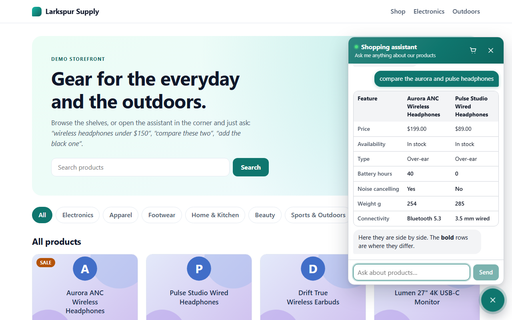
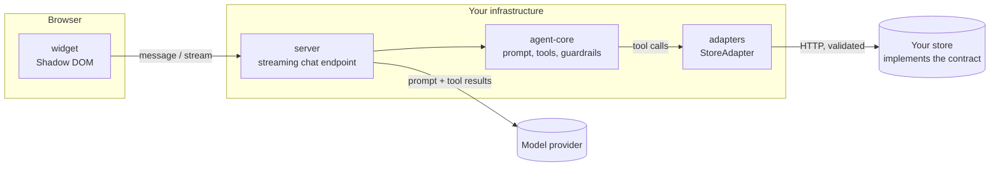

# Agentic Shopping Assistant

An embeddable chat widget whose AI agent does things in your store: it searches, filters, compares, manages the cart and applies discount codes, by calling a small REST API that your store provides.

[](https://github.com/YOUR_GITHUB_USERNAME/agentic-shopping-assistant/actions/workflows/ci.yml)
[](./LICENSE)



<!-- DEMO GIF PLACEHOLDER: record a short walkthrough (search, compare, add to cart, discount,
     checkout) with `pnpm demo:scripted`, save it as docs/assets/demo.gif and replace the
     screenshot above with it. -->

## The problem

Most "AI chat" on shopping sites can only talk. It answers questions from a knowledge base, and when the shopper says _"add the black one"_ it replies with instructions for doing it yourself.

Letting a language model act in a store is risky in a different way. It can invent a price, apply a discount nobody offered, or follow instructions hidden in a product description.

This project is a reference for doing it properly:

- The agent can **act**, through nine narrowly defined tools.
- It can **only** act through your store's own API, so prices, stock, discounts and totals are always the store's numbers.
- The rules that matter are **enforced in code**, not just requested in a prompt.
- A store integrates by implementing **one documented contract** and running a test suite that proves it.

## Features

**For shoppers**

- Streaming chat in a floating widget, with starter suggestions
- Product cards, a side-by-side comparison table and a live cart
- Variant picking when a product comes in several options
- Hand-off to the store's own checkout: the assistant never touches payment
- Keyboard accessible, screen-reader friendly, responsive down to 360 px, left-to-right and right-to-left

**For store owners**

- One `<script>` tag to embed; themable with CSS variables and `data-*` attributes
- Shadow DOM isolation: your CSS cannot break the widget and its CSS cannot leak out
- Works with any store that implements the [Store API contract](./docs/api-contract.md)
- Bring your own model: Anthropic, Google Gemini, Groq, or a local model through Ollama

**For engineers**

- OpenAPI 3.1 contract generated from Zod schemas, with a contract test suite any store can run
- Guardrails in code: cart ownership, discount-code provenance, step cap, error containment
- Rate limiting per IP and per session, strict CORS, server-side conversation history
- 300+ unit and integration tests and Playwright end-to-end tests, all runnable with no API key

## Architecture



The model never talks to the store. It can only ask for one of nine tools to be run; each tool is a small function that calls a `StoreAdapter`, and the adapter is the only code that performs HTTP against the store. More in [docs/architecture.md](./docs/architecture.md).

| Path                    | What it is                                                            |
| ----------------------- | --------------------------------------------------------------------- |
| `packages/api-contract` | Zod schemas, generated OpenAPI 3.1 spec, contract test suite          |
| `packages/adapters`     | `StoreAdapter` interface, REST adapter, Shopify and WooCommerce stubs |
| `packages/agent-core`   | System prompt, tool definitions, guardrails (no server, no provider)  |
| `packages/server`       | Streaming chat endpoint, sessions, rate limiting, CORS                |
| `packages/widget`       | The embeddable widget: script bundle and React component              |
| `apps/mock-store-api`   | In-memory reference store with 36 products                            |
| `apps/demo-store`       | Next.js storefront that embeds the widget; hosts the end-to-end tests |

## Quick start

Requirements: Node.js 20.19 or newer and pnpm 9 or newer.

```bash
pnpm install
```

### Without an API key

```bash
pnpm demo:scripted
```

Open **http://localhost:3100**. This serves the full demo with **scripted replies instead of an AI model**: the agent's tools, the chat server and the store are real, but the assistant only understands a few phrases ("show me headphones", "compare the aurora and pulse", "add the skillet", "apply code WELCOME10", "checkout").

### With a real model

Copy `.env.example` to `.env`, choose `AI_PROVIDER`, and set `AI_MODEL` and that provider's key. Every other variable has a working default.

```bash
pnpm dev
```

Open **http://localhost:3000**. This runs the mock store (`:4000`), the chat server (`:3001`), the demo storefront (`:3000`) and a widget playground (`:5173`).

| Provider       | `AI_PROVIDER` | Key variable                   |
| -------------- | ------------- | ------------------------------ |
| Anthropic      | `anthropic`   | `ANTHROPIC_API_KEY`            |
| Google Gemini  | `google`      | `GOOGLE_GENERATIVE_AI_API_KEY` |
| Groq           | `groq`        | `GROQ_API_KEY`                 |
| Ollama (local) | `ollama`      | none                           |

The model must support tool calling. To see how a given model behaves on the cases that matter (ambiguous requests, injected instructions, discount codes), run:

```bash
pnpm eval:live
```

### Scripts

| Command              | What it does                                                    |
| -------------------- | --------------------------------------------------------------- |
| `pnpm dev`           | Mock store, chat server, demo storefront and widget playground  |
| `pnpm demo:scripted` | Build and serve the demo with scripted replies (no API key)     |
| `pnpm build`         | Build all packages and apps                                     |
| `pnpm test`          | Unit, integration and contract tests (no network, no API key)   |
| `pnpm e2e`           | Playwright end-to-end tests against the scripted demo           |
| `pnpm lint`          | ESLint                                                          |
| `pnpm typecheck`     | TypeScript in strict mode                                       |
| `pnpm contract:test` | Run the contract suite against `STORE_API_BASE_URL` (any store) |
| `pnpm eval:live`     | Agent scenarios against the real model in `.env` (uses tokens)  |

## Embedding the widget

Host `packages/widget/dist/widget.js` with your site and add one line:

```html
<script src="/widget.js" data-store-id="demo" data-api-url="https://your-server" async></script>
```

Optional attributes: `data-primary-color`, `data-position`, `data-greeting`, `data-language`. A React component (`<ShoppingAssistant />`) is also exported. Theming, languages, accessibility and security properties are covered in [docs/embedding.md](./docs/embedding.md).

## Connecting your store

Your store needs to answer nine requests: search products, get a product, create and read a cart, add, update and remove cart items, apply a discount code, and return a checkout link. There are two ways to provide them.

**1. Implement the contract over HTTP** (any language). Follow [docs/api-contract.md](./docs/api-contract.md) or the [OpenAPI spec](./packages/api-contract/openapi/openapi.yaml), then prove it:

```bash
STORE_API_BASE_URL=https://your-store.example/api pnpm contract:test
```

Point the chat server at it with `STORE_API_BASE_URL`, and you are done.

**2. Write a store adapter** (TypeScript), when you would rather call a platform SDK directly:

```ts
import { StoreApiError, type StoreAdapter } from '@agentic-shop/adapters';

export function createMyStoreAdapter(client: MyStoreClient): StoreAdapter {
  return {
    name: 'my-store',
    async searchProducts(params) {
      const result = await client.products.search(params);
      return { items: result.products.map(toContractProduct), nextCursor: result.next ?? null };
    },
    async addCartItem(cartId, item) {
      const product = await client.products.get(item.productId);
      if (product.variants.length > 1 && !item.variantId) {
        throw new StoreApiError(409, 'variant_required', 'Choose an option first.');
      }
      return toContractCart(await client.carts.add(cartId, item));
    },
    // ...the other seven operations
  };
}
```

Rules for an adapter:

- Return contract-shaped objects. Money is `{ amount, currency }` with the amount in minor units (cents), never a float.
- Throw `StoreApiError` for refusals a shopper should hear about (`not_found`, `out_of_stock`, `variant_required`, `discount_invalid`, ...). Throw `StoreUnavailableError` for everything else.
- Compute every total in the store. The agent only reports what you return.

`packages/adapters/src/shopify.ts` and `woocommerce.ts` are stubs that sketch the mapping for those platforms. Pass your adapter to `createServer({ store, ... })` from `@agentic-shop/server`.

## Security

The short version; the long one is in [docs/security.md](./docs/security.md).

| Risk                                          | Defence                                                                                             |
| --------------------------------------------- | --------------------------------------------------------------------------------------------------- |
| The model invents a price or a discount       | Tools return the store's values untouched and do no arithmetic                                      |
| Product text tells the model what to do       | Tool results are marked as untrusted data; the valuable actions are also checked in code            |
| Injected text applies a discount code         | A code is only accepted if the shopper typed it, checked against history the server recorded        |
| The model reaches another shopper's cart      | The cart id lives in the server-side session; no tool accepts one                                   |
| Store text becomes HTML or a link in the page | The widget renders text only; the single link it shows is the checkout button, limited to `http(s)` |
| A client forges conversation history          | The browser sends only the new message; history is kept on the server                               |
| Abuse and runaway cost                        | Per-IP and per-session rate limits, a step cap per turn, message and body size limits               |
| Secrets leak                                  | Keys are never logged or returned; errors shown to clients and the model are generic                |

What the tests do and do not prove: the scripted tests prove every code-level guardrail, even against a model that deliberately misbehaves. They cannot prove that a real model follows the prompt-only rules, such as not adding to the cart unless asked. That is what `pnpm eval:live` is for.

To report a vulnerability, see [SECURITY.md](./SECURITY.md).

## Roadmap

- [ ] Working Shopify adapter (Storefront API)
- [ ] Working WooCommerce adapter (Store API)
- [ ] Redis-backed session store and rate limiter for multi-instance deployments
- [ ] More bundled languages (Urdu, Spanish, French, Hindi)
- [ ] Order status and returns tools
- [ ] Optional signed-in shoppers (pass a customer token through to the store)
- [ ] Observability: structured logs and OpenTelemetry traces per turn
- [ ] A hosted live demo

Smaller, well-scoped starting points are listed in [docs/good-first-issues.md](./docs/good-first-issues.md).

## Contributing

Contributions are welcome. [CONTRIBUTING.md](./CONTRIBUTING.md) explains the setup, the checks every change must pass and the commit conventions.

## Licence

[MIT](./LICENSE)
