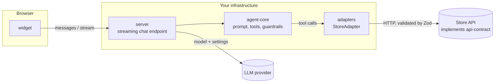
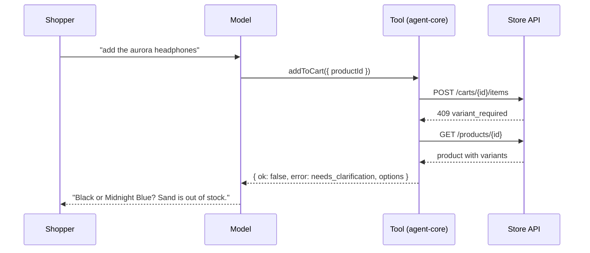

# Architecture

> Status: everything below exists except the demo storefront (Phase 5), which will embed the widget.

## Overview



The model never talks to the store. It can only ask for one of nine tools to be run; each tool is a small function in `agent-core` that calls a `StoreAdapter`, and the adapter is the only code that performs HTTP against the store.

## Packages

| Package                 | Responsibility                                                                                                                                                  | Depends on                             |
| ----------------------- | --------------------------------------------------------------------------------------------------------------------------------------------------------------- | -------------------------------------- |
| `packages/api-contract` | Zod schemas, generated OpenAPI 3.1, contract test suite. The single source of truth.                                                                            | `zod`                                  |
| `packages/adapters`     | `StoreAdapter` interface; `rest` adapter for any contract-compliant store; `mock` preset; stubs for Shopify and WooCommerce.                                    | `api-contract`                         |
| `packages/agent-core`   | System prompt, tool definitions, guardrails. No HTTP server, no model provider.                                                                                 | `adapters`, `api-contract`, `ai`       |
| `packages/server`       | Streaming chat endpoint: sessions with server-side history, rate limiting, CORS, error handling. Chooses the model provider.                                    | `agent-core`, `adapters`, `ai`, `hono` |
| `packages/widget`       | Chat UI in a Shadow DOM: streaming, product cards, comparison table, live cart. Ships as a script and as a React component. No runtime dependency on the agent. | `react` (peer)                         |
| `apps/mock-store-api`   | In-memory reference store with seed data. Used in development and by tests, in-process.                                                                         | `api-contract`, `hono`                 |

`agent-core` uses the Vercel AI SDK only for the `tool()` helper and the step-count stop condition. It never imports a provider package; the caller passes the model:

```ts
import { createShoppingAgent } from '@agentic-shop/agent-core';
import { createRestAdapter } from '@agentic-shop/adapters';
import { streamText } from 'ai';

const store = createRestAdapter({ baseUrl: process.env.STORE_API_BASE_URL! });
const session = loadSession(sessionId); // { cartId?: string }
const agent = createShoppingAgent({ store, session, config: { storeName: 'Acme' } });

const result = streamText({ model, messages, ...agent.settings });
```

## One turn



## Tools

| Tool                | Store calls                           | Changes the cart |
| ------------------- | ------------------------------------- | ---------------- |
| `searchProducts`    | `GET /products`                       | no               |
| `getProduct`        | `GET /products/{id}`                  | no               |
| `compareProducts`   | `GET /products/{id}` for each product | no               |
| `viewCart`          | `GET /carts/{id}`                     | no               |
| `getCheckoutLink`   | `GET /carts/{id}/checkout-url`        | no               |
| `addToCart`         | `POST /carts/{id}/items`              | yes              |
| `updateCartItem`    | `PATCH /carts/{id}/items/{itemId}`    | yes              |
| `removeFromCart`    | `DELETE /carts/{id}/items/{itemId}`   | yes              |
| `applyDiscountCode` | `POST /carts/{id}/discounts`          | yes              |

Every tool resolves with one of two shapes and never throws:

```ts
{ ok: true, notice: '…untrusted…', data: … }
{ ok: false, error: { code, message, details? } }
```

## Guardrails

Each rule is enforced in code where that is possible, and stated in the system prompt as a second layer. The prompt alone is never the only defence for anything an attacker could profit from.

| Rule                                          | In code                                                                                                                                                                                      | In the prompt |
| --------------------------------------------- | -------------------------------------------------------------------------------------------------------------------------------------------------------------------------------------------- | ------------- |
| Never invent prices, stock or discounts       | Tools return the store's values untouched and perform no arithmetic. Even an empty cart's zero totals come from the store.                                                                   | yes           |
| Tool results are untrusted data               | Every success carries a notice marking `data` as untrusted. Descriptions are clipped to 600 characters.                                                                                      | yes           |
| Injected text cannot apply a discount         | `applyDiscountCode` refuses any code that does not appear, as a whole token, in a message the shopper wrote. The store is not even called.                                                   | yes           |
| The model cannot reach another shopper's cart | The cart id lives in the server-side session and no tool accepts one, so the model has no way to name a different cart. (A store's checkout link may embed the shopper's own cart id.)       | n/a           |
| Ambiguous variants need a question            | `addToCart` without a variant on a multi-variant product adds nothing and returns `needs_clarification` with the real options.                                                               | yes           |
| Cart changes need clear intent                | Not decidable in code. Input schemas bound the damage (quantity 1 to 99, ids must exist in the store).                                                                                       | yes           |
| Bounded work per turn                         | `stopWhen: stepCountIs(maxSteps)`, default 8.                                                                                                                                                | n/a           |
| Tool errors are handled gracefully            | Store errors meant for shoppers are relayed. Infrastructure failures (network, timeout, 5xx, auth, malformed responses) collapse to one generic message, so internals never reach the model. | yes           |
| No payment handling                           | There is no payment tool. `getCheckoutLink` returns the store's own URL.                                                                                                                     | yes           |

### What the tests do and do not prove

`packages/agent-core/test/scenarios.test.ts` replaces the model with a script and runs the real tools against the real mock store. That proves the tool wiring and every code-level guardrail, including against a model that deliberately misbehaves (it "obeys" an injected instruction, loops forever, or sends out-of-range input).

It cannot prove that a real model follows the prompt-only rules (clear intent before cart changes, tone, language). `pnpm eval:live` runs a set of scenarios against the real model configured in `.env` for that purpose; it uses tokens and is not part of CI.

## Writing a store adapter

Two routes:

1. **Implement the Store API contract** in your store (or in a thin service in front of it) and use `createRestAdapter`. Verify it with the contract test suite; see [api-contract.md](./api-contract.md).
2. **Implement `StoreAdapter` directly** in TypeScript when you would rather call a platform SDK. Return contract-shaped objects, throw `StoreApiError` for refusals a shopper should hear about and `StoreUnavailableError` for everything else. `shopify.ts` and `woocommerce.ts` are stubs that sketch the mapping.
